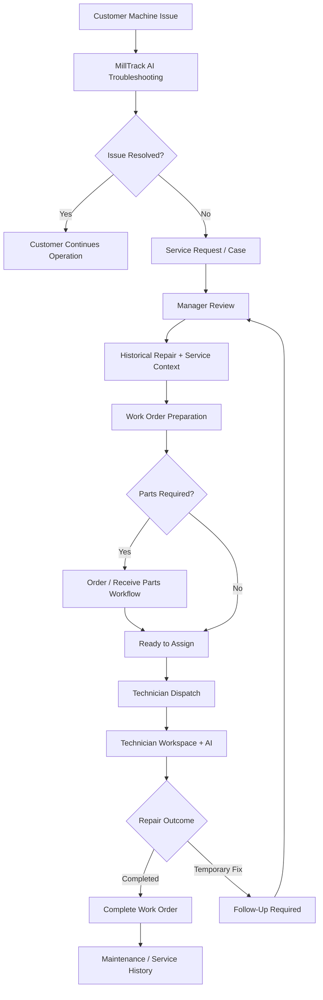
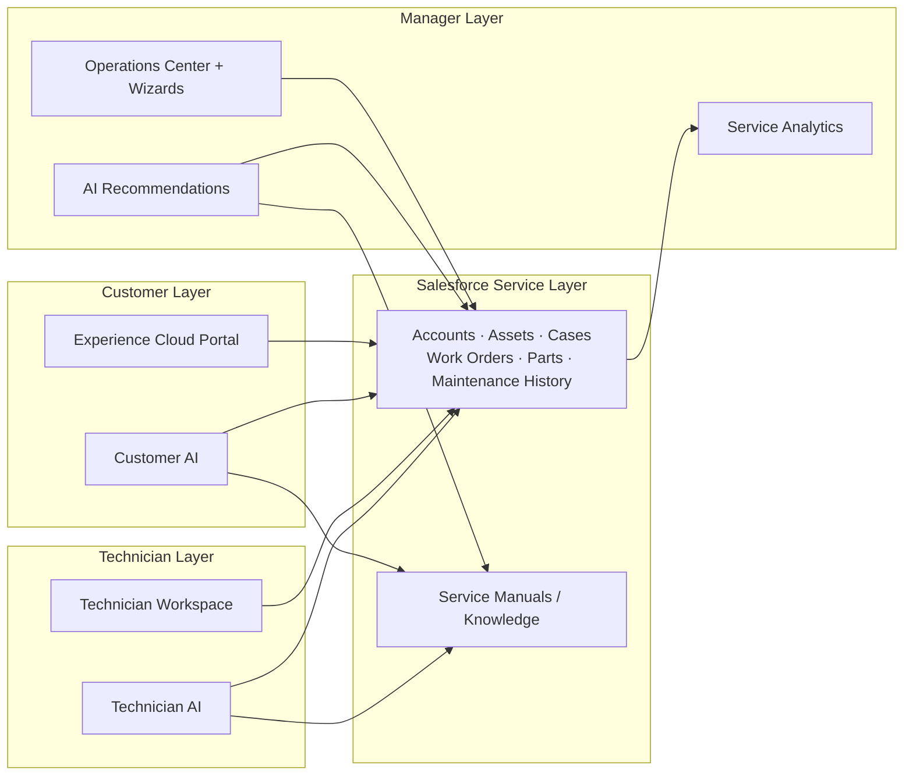

  

# MillTrack Intelligence

**MillTrack Intelligence** is a custom Salesforce service-management application for equipment service organizations. It connects **customers, service managers, and field technicians** through one shared service workflow, and uses **Agentforce** to provide AI-assisted troubleshooting, service recommendations, Work Order context, and technician guidance.

> **Current status:** MillTrack Intelligence is in production with one customer. This is a public showcase repository. The source code is kept private (see [About This Repository](#about-this-repository)).

---

## Demo Video

https://github.com/user-attachments/assets/9f873abd-5e89-4e98-8db8-17deb77a12fc

*2.5-minute walkthrough: a customer troubleshoots with AI, a manager prepares and dispatches the job, and a technician completes the repair.*

---

## Table of Contents

- [Demo Video](#demo-video)
- [The Problem](#the-problem)
- [The Business Case](#the-business-case)
- [How It Works](#how-it-works)
- [User Roles](#user-roles)
- [Customer Experience](#customer-experience)
- [Manager Experience](#manager-experience)
- [Technician Experience](#technician-experience)
- [Agentforce and AI](#agentforce-and-ai)
- [Service Analytics](#service-analytics)
- [Application Architecture](#application-architecture)
- [What I Built](#what-i-built)
- [Technology Stack](#technology-stack)
- [Roadmap](#roadmap)
- [About This Repository](#about-this-repository)

---

## The Problem

In equipment service, customers, managers, and technicians often work from different information. The results are repeated troubleshooting, incomplete handoffs, and **unnecessary site visits**.

- **Customers** wait days for a technician while their machine sits idle.
- **Service teams** send technicians on long-distance trips, sometimes for issues that could have been resolved with remote guidance.
- **Repair knowledge** stays with individual technicians instead of being available for the next service event.

MillTrack brings the whole process into Salesforce, so each person sees the information and actions that matter for their role, and every completed repair makes the next one faster.

---

## The Business Case

*Illustrative estimate, based on a typical cross-border service trip.*

| One long-distance service visit | Approx. cost (CAD) |
|---|---|
| Return flight (e.g. Vancouver → Atlanta) | $1,500 |
| Hotel, 2 nights | $450 |
| Rental car / rides | $250 |
| Meals | $150 |
| Technician time, 2 days | $800 |
| **Total per visit** | **≈ $3,150** |

If AI-guided troubleshooting resolves **1 in 4 calls remotely**, a service team that makes 10 long-distance visits a week avoids roughly **$390K a year** in travel and labour.

For the customer, the benefit is help in minutes instead of days of downtime, and a technician who arrives with the right parts and tools when a visit is needed.

---

## How It Works

1. A **customer** finds a problem with a registered machine and starts with **MillTrack AI** for guided troubleshooting.
2. If the issue still needs service, a **service request** is created, with the troubleshooting already done attached.
3. A **manager** reviews the issue alongside the machine's service history, similar past repairs, and an AI-recommended solution.
4. The manager prepares the **Work Order**, picks the tools and parts, and schedules a technician.
5. The **technician** gets a workspace built for that job, plus an AI assistant grounded in the Work Order.
6. The completed repair, including its root cause, becomes part of the machine's **maintenance history**.

---

## User Roles

### Customer
Uses an Experience Cloud portal to view their registered machines, review service history, troubleshoot with AI, report new issues, and track service requests and Work Orders.

### Manager
Coordinates the service operation: reviews incoming Cases, compares them with historical repairs, prepares Work Orders, manages parts, dispatches technicians, and follows up on temporary fixes.

### Technician
Gets a focused workspace for each job: the reported issue, the manager's guidance, recommended tools, parts, machine context, service history, and a Work Order-scoped AI assistant.

---

## Customer Experience

  

- **My Machines**: registered equipment and machine details
- **Service Requests**: track open service Cases
- **Work Orders**: follow active service work
- **Report an Issue**: guided workflow for creating a new service request
- **Machine Service History**: previous maintenance and completed repairs
- **MillTrack AI**: Agentforce-powered support for initial troubleshooting

The AI collects useful troubleshooting context before a manager or technician gets involved, so better information flows into the rest of the service workflow.

---

## Manager Experience

  

The **Manager Operations Center** groups all service work by stage, so managers can see where work is piling up and what needs to happen next:

**Requires Review → Follow-Up Required → Parts to Order → Waiting on Parts → Ready to Assign → Assigned Visits → Active Repairs**

Guided wizards take the manager through reviewing a Work Order (with historical repair precedent and an AI-recommended solution), choosing tools, ordering and receiving parts, and dispatching a technician based on their live availability.

---

## Technician Experience

  

The technician workspace is designed around one question:

> **What does the technician need to know to complete this job successfully?**

- **Technician Copilot**: the reported issue, recommended repair direction, tools to bring, machine details, service history, and ordered parts, all in one place
- **Technician AI**: an Agentforce assistant scoped to the current Work Order. Ask for a briefing, the tools needed, ordered parts, machine history, or relevant service-manual information
- **Job actions**: start work, request more parts, record a temporary fix and follow-up, or complete the repair with root cause and labour

---

## Agentforce and AI

AI isn't a standalone chatbot here. It's built into each stage of the service lifecycle:

| Stage | What the AI does |
|---|---|
| Customer | Guided troubleshooting and issue collection before escalation |
| Manager | Issue summaries, recommended actions, and relevant historical repairs for Work Order preparation |
| Technician | Answers grounded in the current Work Order, machine, and service documentation |

Responses are grounded in Salesforce data (Cases, Work Orders, Assets, Maintenance Logs, parts, and account context) and in service-manual content. That keeps answers tied to the actual machine and service event.

> **Demo note:** Manufacturer service manuals are proprietary, so the demo knowledge base contains only publicly available manuals. Answers in the demo are more general than they would be with an OEM's full service documentation.

---

## Service Analytics

  

The **Machine Service Intelligence** view shows which equipment takes the most service effort, using these metrics: service visits, unique issues, technician labour hours, follow-up visits, resolved visits, and activity by machine model over configurable reporting periods.

---

## Application Architecture

---

## What I Built

I designed and developed MillTrack end to end, drawing on my background as a dental CAD/CAM field service technician:

- **25 custom Lightning Web Components** across three role-based experiences, replacing generic record pages with workflow-driven UIs
- **Apex** controllers and services behind every workflow, with test coverage
- **Three Agentforce experiences** (customer, manager, technician), grounded in Salesforce data and service documentation through Prompt Builder
- **Experience Cloud** customer portal with account-scoped access
- **Guided multi-step wizards** for Work Order review, parts ordering and receiving, dispatch, temporary fixes, and completion
- **Role-based security** using Profiles, Permission Sets, field-level security, and sharing
- **Custom analytics** for service activity by machine model

---

## Technology Stack

| Area | Technology |
|---|---|
| Platform | Salesforce |
| Backend | Apex, SOQL |
| Frontend | Lightning Web Components (LWC), SLDS |
| Customer Portal | Experience Cloud |
| Automation | Salesforce Flow |
| AI | Agentforce, Prompt Builder |
| Security | Profiles, Permission Sets, Sharing & Field-Level Security |
| Reporting | Reports, Dashboards, custom LWC analytics |
| Development | Salesforce CLI, Git, JavaScript, HTML, CSS |

---

## Roadmap

- **AI manual images and diagrams**: show relevant diagrams and photos from the service manual alongside AI instructions, with page references
- **Supplier ordering integration**: submit parts orders, receive confirmations, and track shipments through supplier APIs without leaving MillTrack
- **Separate conversation threads**: verified portal users currently keep one continuous chat history; the next step is a fresh thread per issue
- **Expanded knowledge coverage**: more machine models and full OEM service documentation
- **Service intelligence**: repeat failures, first-visit fix rate, parts usage, and recurring root causes
- **Predictive maintenance**: use maintenance history to spot patterns before failures happen

---

## About This Repository

This is a **showcase repository**. MillTrack is in production with a customer, so the source code, metadata, and configuration are kept in a private repository.

**Code walkthroughs are available on request** for hiring teams and potential partners.

Screenshots and demo records use demonstration data. MillTrack is an independent project and is not affiliated with or endorsed by any equipment manufacturer shown or named in the demo.

---

**Shyam Sharda** · Salesforce Developer · Vancouver, BC
https://www.linkedin.com/in/shyam-sharda-7a623413a/

*Built with Salesforce, Apex, Lightning Web Components, Experience Cloud, Flow, Agentforce, and Prompt Builder.*
